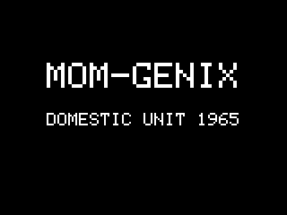

# MOM-GENIX Halloween display

Arduino C++ firmware for a 320x240 ESP32 costume display: ten messages, automatic
cycling, tap to advance and hold to pause/resume. Includes separate ILI9341 and
ST7789/CYD2USB profiles, native state-machine tests and matching screen previews.



Tier 1A software milestone, October 22, 2026. Target: October 31, 2026.
Both costume firmware profiles compile; focused tests execute the actual C++ state
machine and renderer on Windows. **No physical board, upload, pressure calibration,
readability, power-bank endurance, or hardware-tested dependency combination is
claimed.** Complete [HARDWARE_CHECKLIST.md](HARDWARE_CHECKLIST.md) before handoff.

The complete v1.3 specification is retained in
[`docs/MOM_GENIX_Display_Specification.docx`](docs/MOM_GENIX_Display_Specification.docx).
Functional requirements follow that document. Physical bring-up is pending.
Original manual wording is used only as selected by the specification.

Start with the Windows commands below, inspect [the ten-message preview](preview/all_messages.png),
and use [the review packet](REVIEW_PACKET.md) for software verification evidence.

## Windows setup and build

Install 64-bit Python 3.12 with the Python launcher. In PowerShell in this folder:

```powershell
py -3.12 -m venv .venv
.\.venv\Scripts\python.exe -m pip install -r requirements-build-lock.txt
.\.venv\Scripts\python.exe -m platformio run
```

No environment activation or execution-policy change is needed. The first build
requires network access. PlatformIO tools/packages stay in `.platformio`, outputs
in `.pio`. If the OS/sandbox blocks downloaded compiler executables, allow those
local build processes through the host's normal approval mechanism.

```powershell
.\.venv\Scripts\python.exe -m platformio run -e cyd_ili9341
.\.venv\Scripts\python.exe -m platformio run -e cyd_st7789
```

Exact compile-verified versions: PlatformIO Core 6.1.18, espressif32 6.10.0,
Arduino ESP32 2.0.17 (package 3.20017.0), toolchain 8.4.0+2021r2-patch5,
esptool package 1.40501.0, SCons package 4.40801.0, TFT_eSPI 2.5.43,
XPT2046_Touchscreen v1.4 commit `d57f64c8b5f2bc5b8d10d121550806eeff7b06d9`.
The archive dependency's PlatformIO display version is synthetic; its immutable
commit URL and `library.properties` identify the exact upstream version.
Hardware-tested versions: **none**. Do not upgrade during final validation.
`requirements-build-lock.txt` locks resolved Python tool dependencies on Windows
Python 3.12. Host verification additionally pins Zig 0.13.0.

## Host tests and local previews

```powershell
.\.venv\Scripts\python.exe -m pip install -r requirements-host.txt
.\.venv\Scripts\python.exe tools/verify.py
```

This compiles and runs `tests/state_machine_tests.cpp` together with the exact
`lib/MomGenix/src/*.cpp` files used by PlatformIO. It also executes the same renderer
on a checked host raster canvas. No copied JavaScript/Python model substitutes for
firmware logic. See `test-results.txt` for actual results.

Open [preview/index.html](preview/index.html) locally, or inspect
[all ten messages](preview/all_messages.png). Individual PNGs are exactly 320 by
240. Startup and PAUSED frames are included. Shared C++ data, wrapping, font and
pixel drawing produce the same intended pixels on the device. Differences:
host RGB565 expands to PNG RGB888; actual LCD color order, inversion, gamma,
brightness, subpixels, orientation, viewing angle and viewing distance are untested.
There is no simulated electrical/touch validation. HTML captions are preview-only.

Headings use a 32px cell, body 24px; three long bodies require four lines. The
renderer supports a 16px body fallback if future wording needs it. Current content
fits without it. The 5x7 bitmap is intentionally pixelated and integer-scaled.
UTF-8 ellipsis remains in `messages.h` and renders as a custom single-cell glyph.
Hyphen-aware wrapping splits Passive-aggressive across lines while retaining the
hyphen. No wording is shortened. New overflowing content shows LAYOUT ERROR rather
than silently clipping. Test readability at 3-6 feet in the final mount before
approving it; six-foot readability is a goal, not an assurance.

## Upload and board identification

Disconnect the USB power stick before programming from a PC. Use a data-capable
USB-A-to-micro-USB or USB-A-to-USB-C cable matching the delivered connector.

```powershell
.\.venv\Scripts\python.exe -m platformio device list
.\.venv\Scripts\python.exe -m platformio run -e diagnostic_ili9341 -t upload --upload-port COM5
.\.venv\Scripts\python.exe -m platformio device monitor --port COM5 --baud 115200
```

Replace COM5 with Device Manager's port. Use `diagnostic_st7789` for ST7789. These
builds display color bars, text and raw touch pressure/coordinates and print at
10Hz. The costume builds are `cyd_ili9341` and `cyd_st7789`; upload with the same
command after changing `-e`. If automatic bootloader entry fails, hold BOOT during
connection/start of upload and release when it connects. Identify the USB bridge
before selecting its vendor driver if no COM port appears. No upload was attempted.

Photograph both board sides, panel markings, USB ports, RGB and light-sensor
positions. Connector count is a clue, not proof. Select a controller using supplier
information, markings and visual smoke tests. Verify red, green, blue, black,
white, coverage and orientation against [pinned evidence](docs/BOARD_PROVENANCE.md).
The ST7789 profile deliberately matches upstream BGR and inversion OFF. Do not
change that based solely on another clone's settings. Check physical behavior.

## Touch calibration and gesture details

`lib/MomGenix/src/timing_config.h` holds timing and pressure configuration;
`include/config.h` holds hardware, brightness and independent optional flags.
Pressure defaults **600 press / 450 release**, 50ms stable release, are engineering
starting points, not calibrated values. XPT2046 v1.4 clamps Z below 400 to zero;
keep calibrated hysteresis above that library cutoff. Adjust only after observing
release noise and comfortable finger pressure across all corners and center.
Log dark/indoor/mounted behavior where relevant, actual thresholds and date in the
hardware checklist. Set `kTouchCalibrated` true only after recording calibration.
The firmware still runs while that metadata flag is false; serial warns on boot.

Rotation is 1 for both touch and display. Whole-screen gestures use pressure only;
coordinates cannot exclude a corner. For coordinate calibration, record extrema
and axis direction at four corners and center; any future mapping should clamp,
map measured extrema and apply measured swap/inversion. No borrowed calibration
or invented extrema are used. Repeat touch tests in the mount, with no panel stress.

Startup lasts 3000ms from showing the completed identity screen. It ignores
startup gestures; normal touch detection begins on entry to AUTO. A held finger
at that transition begins a new candidate then. Phase 2 startup gestures are absent.
Each message lasts 7000ms. Pressure must strictly exceed press threshold for 50ms.
Initial candidate touch-down freezes the cycle immediately and anchors the 2000ms
hold. Before qualification, falling below press threshold resets the 50ms high
qualification; hysteresis retains the contact until release threshold is crossed.
Once qualified, intermediate pressure retains the gesture. A short release bounce
belongs to the same candidate, and does not rearm it.

At 2000ms, AUTO/PAUSED toggles once while still held. A sampled release exactly at
or after that boundary is also a hold. A 1999ms release remains a tap despite its
50ms release debounce. Only after stable release does a tap advance once. PAUSED
taps remain paused. Any release in AUTO, including rejected noise, starts a fresh
7000ms interval; release debounce remains part of the freeze. Hold release never
advances. Touch is processed before a simultaneous expiry. Progress freezes from
candidate onset and while PAUSED. Unsigned elapsed subtraction handles millis()
rollover; timing assumes the loop is serviced normally within a 32-bit millis epoch.

## Architecture and scope

- `lib/MomGenix/src/messages.h`: exact ten records, explicit severity, duration.
- `state_machine.*`: portable STARTUP/AUTO/PAUSED and touch/timer rules.
- `layout.*`, `renderer.*`, `font_data.h`: shared regional drawing and text wrapping.
- `include/board_setup.h`: TFT_eSPI profile forced into all library translation units.
- `src/hardware.cpp`: dedicated touch VSPI, display HSPI, GPIO21 backlight ownership.
- `src/main.cpp`: 5ms sampling target, input then state then changed-region rendering.
- `tests/`, `tools/verify.py`: native C++ tests and deterministic preview generation.

Only initialization/startup transition clear the full screen. Message changes
clear the message region; mode label and progress bar update separately. No PSRAM
or full-screen device buffer is required. TFT_eSPI touch and TFT_BL are deliberately
undefined and guarded; its TOUCH_CS warning is expected, not a missing touch bus.
RGB pins are set HIGH (active-low off); GPIO34 is not sampled. Tier 1B features are
independently disabled and unimplemented; compile guards reject accidental enabling.
The fixed backlight is adjustable, default 153/255 (60%), at 5kHz using the pinned
core 2.x LEDC API. Wi-Fi is set OFF, Bluetooth is stopped. There is no wireless
editor/AP/server, Bluetooth feature, audio, external sensor, SD use or persistence.

## Power, mounting and release

Firmware boots from regulated USB 5V without a PC or network. Actual operation
from the ordered stick remains a physical test. Use USB-A output with the matching
cable. The specification starts with an enclosed 3000-5000mAh bank rated at least
5V/1A, with a verified always-on/low-current mode if needed. No purchase is needed
for this software task. Record the actual model, mode-entry procedure and any mode
timeout; no universal low-load cutoff or runtime can be inferred from capacity.
Test at the lowest configured duty for the full intended wear duration plus margin.
If it shuts off, use a verified bank mode or adjust fixed brightness and repeat;
do not add a keep-alive load or additional hardware to this build.

Keep the rear RGB decorative path optional. Protect the board and USB connection
from skin, exposed metal and cable strain, leave touch unobstructed, avoid pressing
on the resistive panel, and check tilt, standing-height readability and comfort.
Proposed software freeze: October 29, 2026, earlier if needed for handoff. Late
hardware means Tier 1A only. Optional work has not begun.

The original local workspace has a compile/host-tested backup under
`milestones/tier1a-2026-10-22/`, with binaries, source archive and checksums.
Local backups are excluded from Git; a fresh clone can reproduce the firmware
using the pinned setup and tests above. This is not a hardware-tested release.
See [REVIEW_PACKET.md](REVIEW_PACKET.md) for review
questions, verification evidence and remaining physical checks.

## Halloween content editing by USB

Edit `lib/MomGenix/src/messages.h`, preserving the ten records and their explicit
Severity values and durationMs. Supported glyphs are printable ASCII plus the
existing UTF-8 ellipsis. Keep headings uppercase and brand MOM-GENIX uppercase.
Re-run host verification, inspect regenerated previews, then build/upload the
identified board profile by USB. Wording changes from v1.3, including shortening
for mounted readability, require user approval. Power-cycle to return to startup;
there is no flash-stored pause or configuration state to clear.

## Repository contents and licensing

Git includes firmware, both board profiles, exact dependency configuration, tests,
preview images/gallery, the authoritative specification, verification logs, review
packet and hardware checklist. `.gitignore` excludes local tool environments,
downloaded libraries/toolchains, build outputs, local milestone archives, editor
files and the earlier reference manual. No installed dependencies are vendored.
The small shared bitmap font retains its notice in `THIRD_PARTY_NOTICES.txt`.

This repository uses the [MIT License](LICENSE) selected when the GitHub repository
was created. Retain `THIRD_PARTY_NOTICES.txt` with the identified upstream material.
